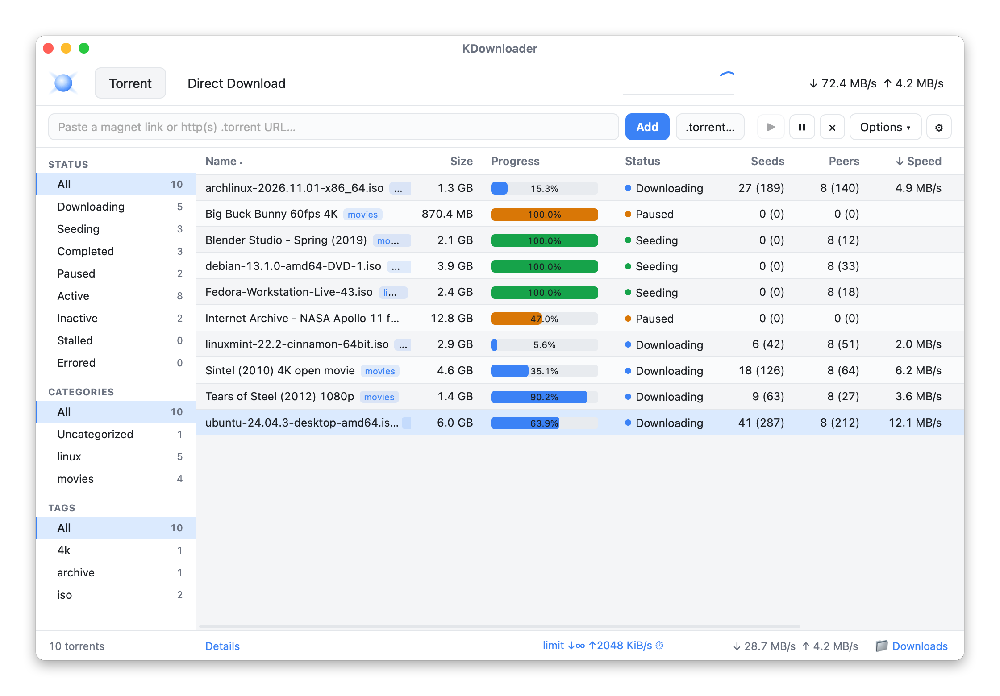
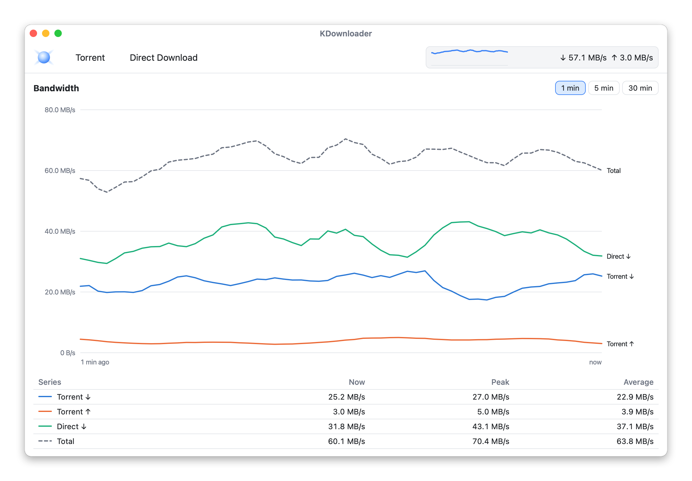
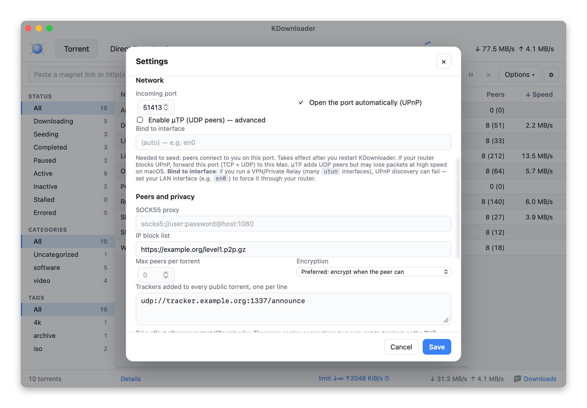
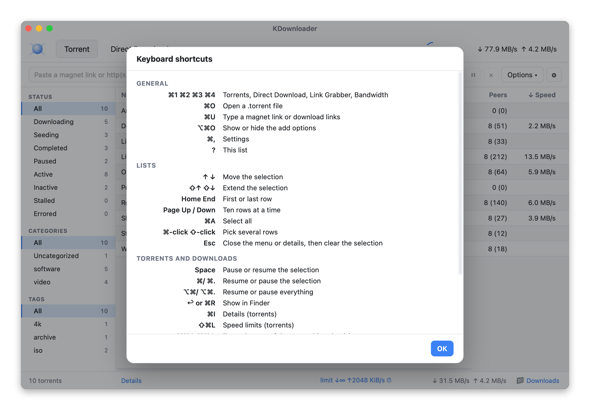
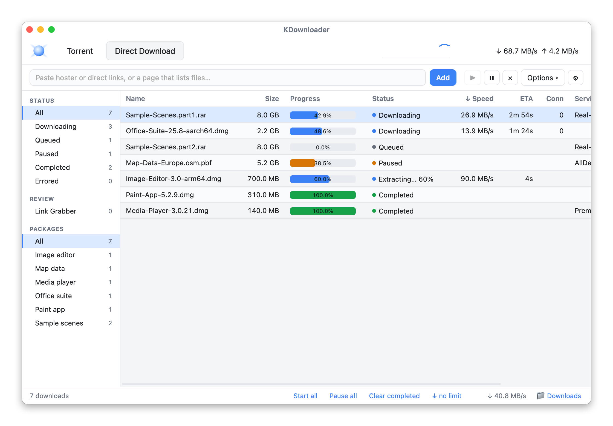
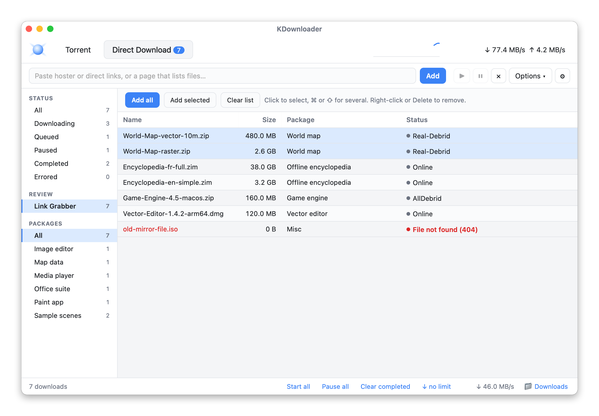

# KDownloader

A light download manager and BitTorrent client for macOS, named as a nod to JDownloader.

The torrent side is Transmission-weight, built on the
[`librqbit`](https://crates.io/crates/librqbit) engine and [Tauri 2](https://tauri.app).
Next to it, a **Direct Download** tab handles links, hosters and premium accounts (see below).

No bundled browser: the UI runs in the macOS system WebView, so the app is a
small native binary rather than a 150 MB Electron bundle.



### Support the project
Free and open-source 🙂 — if you feel like it, buy me a few tokens:

[](https://paypal.me/lbenh)

## Features

### Torrents

- Add torrents by **magnet link**, **http(s) `.torrent` URL** or **local `.torrent` file** (⌘O,
  or as the system's default handler for magnets and `.torrent` files)
- Start / pause / resume / force re-announce; remove, optionally moving the files to the Trash
- Live progress, speeds, ETA, ratio, seeds and peers (with the tracker's swarm counts)
- **Details panel**: general info, trackers, connected peers, and per-file content
- **Per-file selection**: choose which files to download, at add time or later
- **Per-torrent save path** and **categories / tags**, with a category filter
- **Resume across restarts** (session persistence + fastresume)

### Speed and scheduling

- **Global limits**, adjustable live
- **Per-torrent limits**, set at add time or changed any time from the right-click menu (⇧⌘L)
- **Scheduler**: alternate limits during a daily time window
- **Bandwidth tab**: a live speed chart, plus a speed meter on the Dock icon



### Network and privacy

- **Protocol encryption (MSE/PE)**: *Preferred* (encrypt when the peer can), *Required* (encrypted peers
  only) or *Off*. It hides BitTorrent traffic from providers that throttle it, and lets you reach
  private-tracker swarms that require it. It doesn't hide your IP address.
- **SOCKS5 proxy** for peer connections
- **IP block list** (a URL to a P2P-format list)
- **Extra trackers** added to every public torrent (never to private ones)
- **Max peers per torrent**
- Incoming port with **UPnP** (IGD v1 and v2, which librqbit's own forwarder misses), optional **µTP**,
  and binding to a network interface (useful with a VPN)
- Logs show only the tracker host, since private-tracker URLs carry a passkey



### Automation

- **Watch folder**: auto-adds `.torrent` files dropped into a folder (with an optional category), then moves
  them to `.kdownloader-added`
- **RSS auto-download**: polls feeds and adds items whose title matches your regex rules

### Keyboard

A native menu bar with Transmission-style shortcuts: ⌘O open, ⌘U add links, ⌘1–4 tabs, ⌘I details,
⌘/ and ⌘. resume / pause, ⌥⌘/ and ⌥⌘. for everything, ⌘R show in Finder, ⌥⌘↑↓ queue order, ⌘, settings.
Lists take arrows, ⇧-arrows, Home/End, Page Up/Down, Space (pause/resume), Return, ⌫ (remove)
and ⌥⌘⌫ (move to Trash). Press **?** for the full list.



### Not included / known limits

- **Sequential download** is not offered: the app doesn't expose a streaming-order mode.
  Per-file selection is the closest control.
- **Search plugins** (qBittorrent-style site scrapers) are intentionally not bundled: that's a separate
  subsystem that scrapes torrent indexers, with real legal/ToS considerations. Can be added later against
  a legitimate indexer API if you want it.
- Network settings (port, µTP, proxy, block list, extra trackers, peer limit, encryption) take effect after
  a restart. Changing the global download folder applies immediately to newly added torrents;
  already-added torrents keep their folder.
- The engine is a vendored copy of librqbit with MSE support (rqbit PR #633) and a few patches,
  listed in `src-tauri/vendor/rqbit/KDOWNLOADER-PATCHES.md`.

All app settings live in `~/Library/Application Support/com.kdownloader.desktop/`.

## Project layout

```
KDownloader/
├── src-tauri/              Rust backend (Tauri app)
│   ├── src/lib.rs          torrent session + Tauri commands
│   ├── src/menu.rs         menu bar and shortcuts
│   ├── src/direct/         Direct Download engine, link grabbing, debrid providers, Click'n'Load
│   ├── src/rss.rs          RSS auto-download
│   ├── src/watch.rs        watch folder
│   ├── src/upnp.rs         UPnP port forwarding
│   ├── src/dock.rs         Dock speed meter
│   ├── src/handler.rs      default handler for magnets and .torrent files
│   ├── vendor/rqbit/       patched librqbit (MSE encryption)
│   └── tauri.conf.json
└── ui/                     Frontend (vanilla HTML/CSS/JS, no bundler, no npm)
    ├── index.html, styles.css
    ├── table.js            shared list, menu and shortcut code
    ├── main.js             Torrents tab
    ├── direct.js           Direct Download tab
    └── bandwidth.js        Bandwidth tab
```

## Develop

```sh
cd src-tauri
cargo tauri dev
```

## Build a distributable app + .dmg

```sh
cd src-tauri
cargo tauri build
```

Output lands in `src-tauri/target/release/bundle/`:

- `macos/KDownloader.app` — the application
- `dmg/KDownloader_0.2.1_aarch64.dmg` — a drag-to-install disk image

> The build is ad-hoc signed. See **Install on macOS** below for why that
> matters for automatic UPnP, and how to fix it for free.

## Install on macOS

KDownloader is not Apple-notarized, so after you download or build it, do a one-time
local signing step — otherwise macOS silently blocks the app's **local network**
access, and automatic **UPnP** port-forwarding (so peers can reach you) won't work.

```sh
# signs /Applications/KDownloader.app by default; pass a path for another location
./scripts/kdownloader-macos-sign.command
```

The script creates a **stable, locally-trusted code-signing certificate** (its
private key is generated on your machine and never leaves it), clears the
download-quarantine flag, and signs the app. You'll be asked for your macOS login
password once, to trust the certificate. Then:

1. Launch KDownloader.
2. **System Settings → Privacy & Security → Local Network → enable KDownloader.**

That's it — UPnP then opens your BitTorrent port automatically, the way other
clients do, and the permission sticks.

- Undo at any time: `./scripts/kdownloader-macos-sign.command --remove`.
- It works with both the macOS system OpenSSL (LibreSSL) and Homebrew OpenSSL.
- **Distributing to non-technical users?** Proper **Developer ID signing +
  notarization** (an Apple Developer account) removes this step entirely — it's
  the paid, turnkey version of what this script does for free.
- **Linux / Windows:** no signing needed; UPnP works out of the box.

## Possible next steps

- RSS "smart episode" filters and per-feed scheduling
- Search against a legitimate indexer API (opt-in)
- Applying network settings without a restart

## Direct Download

The **Direct Download** tab is a light download manager next to the torrent client:
link grabbing, multi-connection HTTP downloads with resume, packages, automatic
extraction, and premium accounts through the official APIs of Real-Debrid, AllDebrid,
Premiumize, Debrid-Link, Uploadedpremiumlink, TorBox, Mega-Debrid, Cocoleech and
Fakirdebrid. API keys are stored in the macOS Keychain.

Free hosts with a direct file address work without an account: **pixeldrain** share
links (`/u/…`) download with resume, and albums (`/l/…`) expand into their files.
Hosts that check for a real browser before showing a file, such as **workupload**,
open in a small window: once the page is ready, start the download there and
KDownloader takes it over, with that window's session.

Copied links are routed automatically: magnets and `.torrent` URLs prefill the Torrent
tab, and other file links start at once, or wait in the Link Grabber if you turn that off. The code lives in `src-tauri/src/direct/`
and `ui/direct.js`; the engine is independent of Tauri and tested with `cargo test direct::`.

Multi-volume RAR sets extract once their last volume arrives, and a failed extraction
can be retried from the right-click menu. Deleted files go to the Trash.

Link protectors open in a small window where you solve the captcha yourself. KDownloader also
listens for Click'n'Load on `127.0.0.1:9666`: links from a known protector start at once,
and links from any other page wait in the Link Grabber.

Out of scope: captcha solving, dodging hoster limits, container decryption, protected streams.




The screenshots use made-up demo data: invented names, example.org URLs and reserved example IP addresses.
