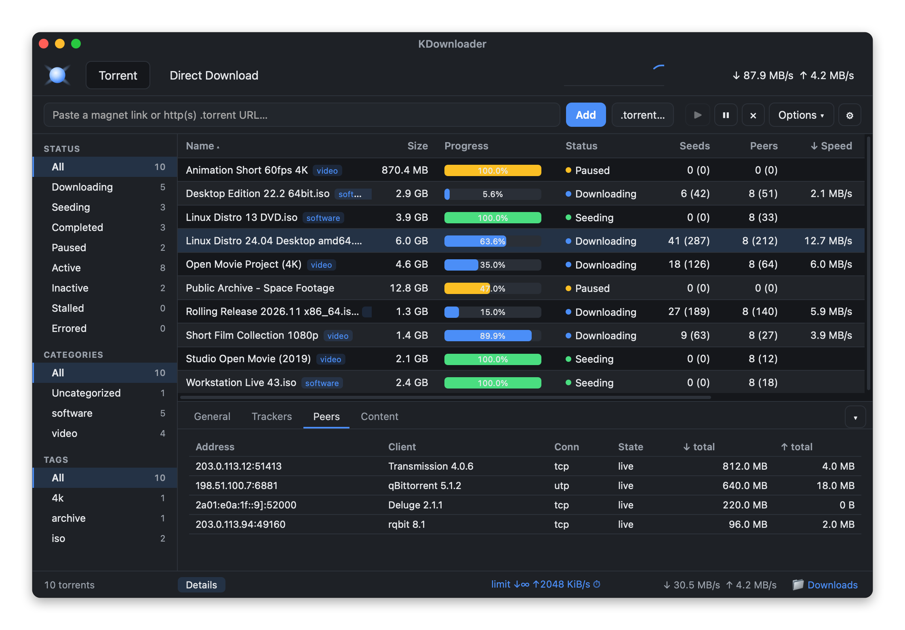
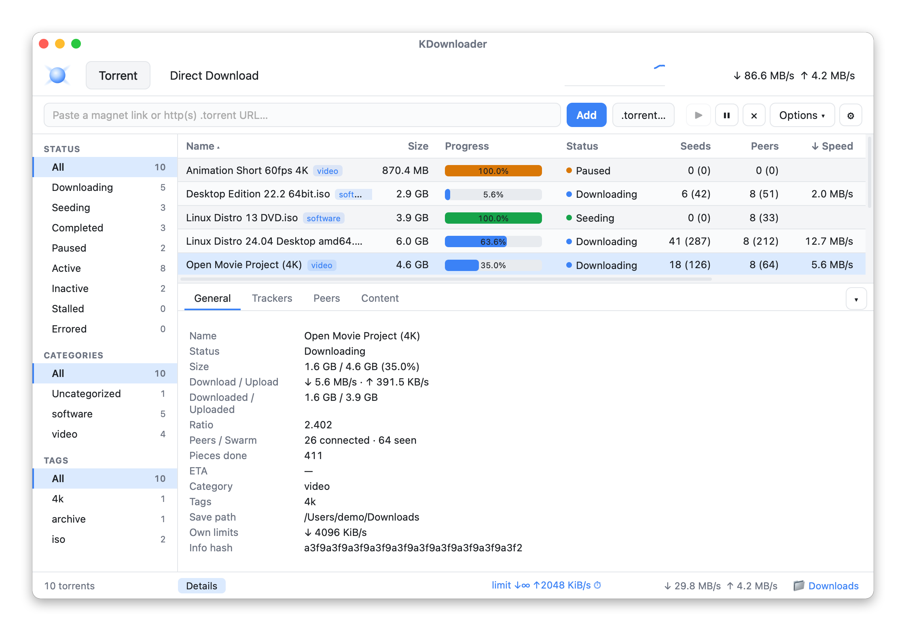
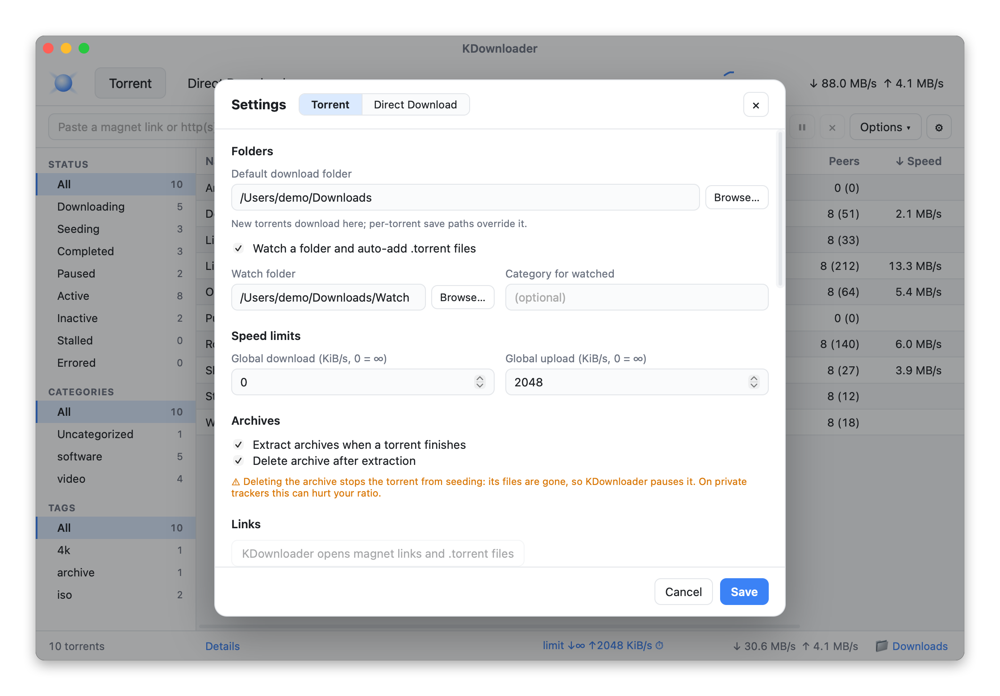
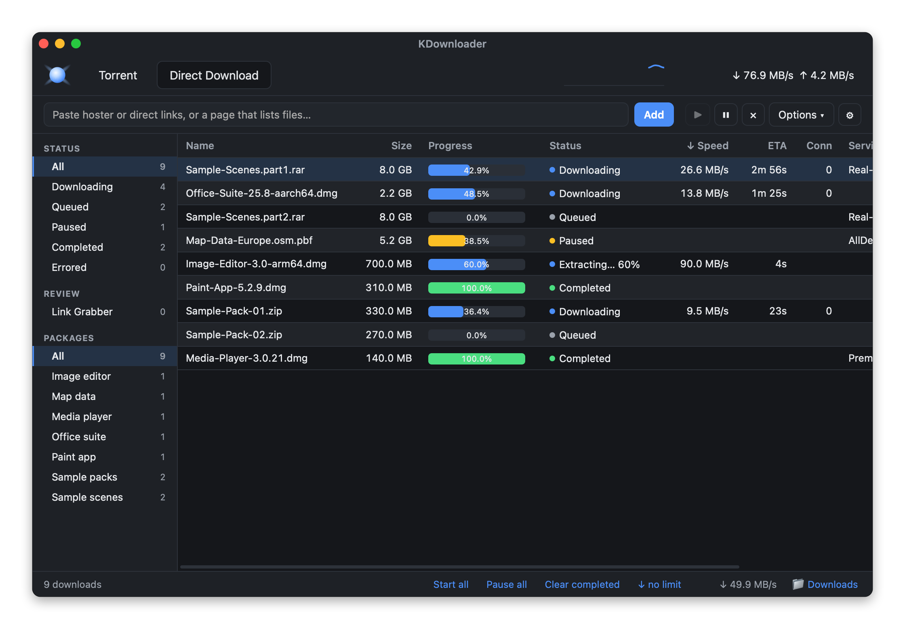
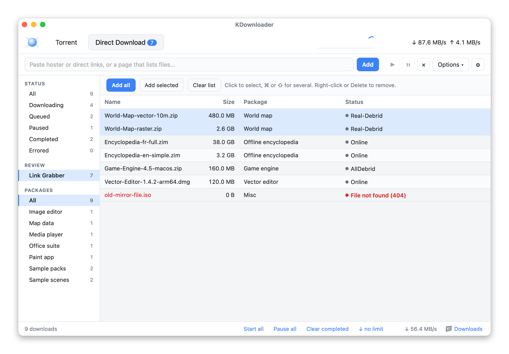
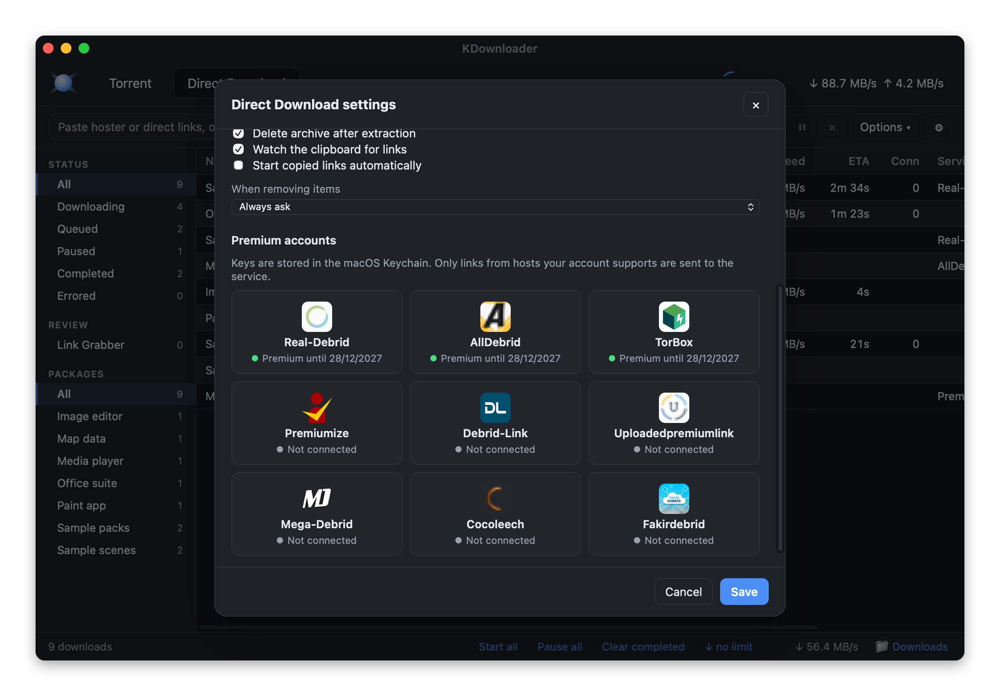
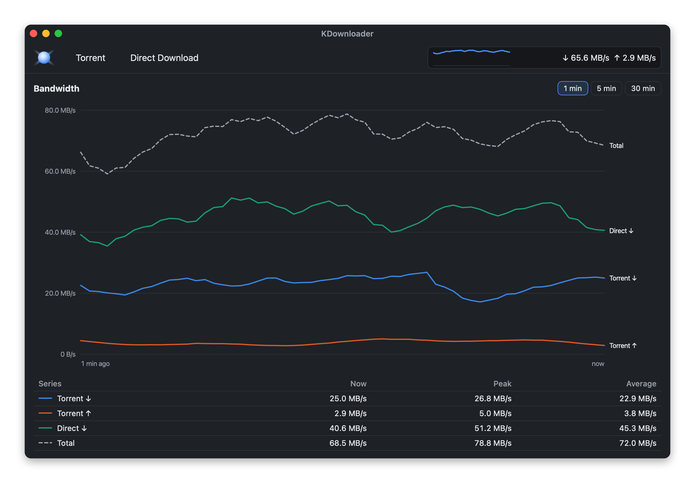
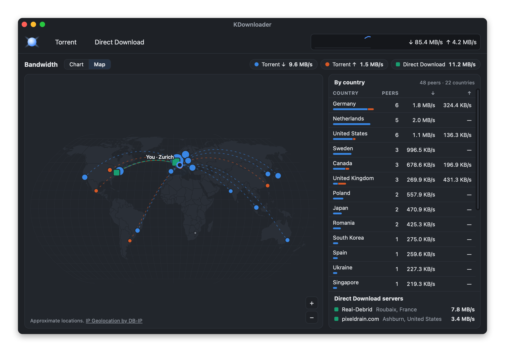
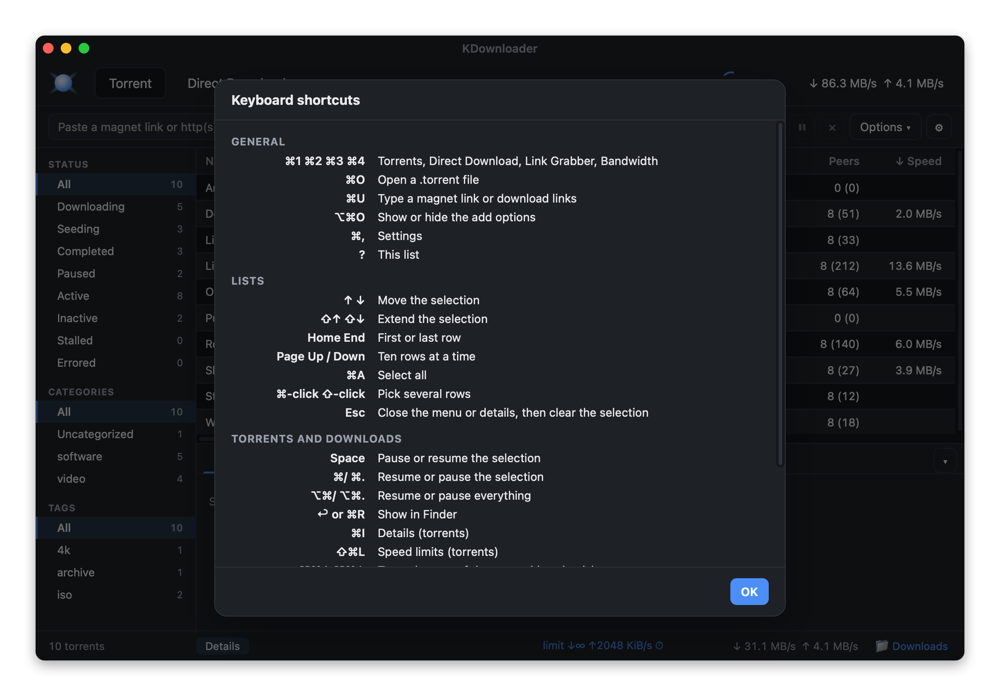

# KDownloader

**Copy a link. That's it.** KDownloader watches your clipboard. Copy a MEGA folder, a Google Drive
file or a debrid-able hoster link anywhere on your Mac, and it's already downloading, sorted into
packages and unpacked when done. Copy a magnet, and it's waiting in the Torrent tab.

One small native app does what usually takes three: a BitTorrent client, a download manager and a
debrid front-end. It's named as a nod to JDownloader, without the Java.

- **Torrents** at Transmission weight, on the [`librqbit`](https://crates.io/crates/librqbit) engine
- **Direct Download** through nine premium debrid services, or straight from nine free hosts:
  MEGA, Google Drive, Dropbox, MediaFire, WeTransfer, pixeldrain and more. It even gets past the
  browser checks that hosts put in front of downloaders.
- **Hands-free**: links are checked, grouped into packages, downloaded over several connections
  with resume, and the archives are extracted. Link protectors and Click'n'Load go to the same queue.
- **A world map** of the peers and servers you exchange data with, live
- **Truly native**: about 10 MB, the macOS system WebView through [Tauri 2](https://tauri.app), not
  a 150 MB Electron bundle. It has a menu bar, notifications and a speed meter on the Dock icon.



### Support the project
Free and open-source 🙂 — if you feel like it, buy me a few tokens:

[](https://paypal.me/lbenh)

**Contents:** [Torrents](#torrents) · [Direct Download](#direct-download) ·
[Bandwidth](#bandwidth) · [Keyboard](#keyboard) · [macOS integration](#macos-integration) ·
[Install](#install-on-macos) · [Windows and Linux](#install-on-windows-and-linux) · [Build](#build-from-source) · [Known limits](#known-limits)

## Torrents



### Adding and managing

- Add torrents by **magnet link**, **http(s) `.torrent` URL** or **local `.torrent` file** (⌘O),
  or open them from anywhere: KDownloader can be the default handler for both
- Start / pause / resume / force re-announce; remove, optionally moving the files to the Trash
- Live progress, speeds, ETA, ratio, seeds and peers (with the tracker's swarm counts)
- **Details panel**: general info, trackers, connected peers, and per-file content
- **Per-file selection**: choose which files to download, at add time or later
- **Per-torrent save path** and **categories / tags**, with filters in the sidebar
- **Resume across restarts** (session persistence + fastresume)
- **Archive extraction**, off by default: a finished torrent's ZIP, 7z, RAR (multi-volume too) and
  tar archives are unpacked next to them. Deleting the archive afterwards is a separate option:
  the torrent can't seed the deleted files any more, so it's paused.
- **Delete archive after extraction, per torrent**: from the right-click menu of a torrent that
  has archives and hasn't finished. It's extracted, then cleaned up, whatever the setting says.



### Speed and scheduling

- **Global limits**, adjustable live
- **Per-torrent limits**, set at add time or changed any time from the right-click menu (⇧⌘L)
- **Scheduler**: alternate limits during a daily time window

### Network and privacy

- **Protocol encryption (MSE/PE)**: *Preferred* (encrypt when the peer can), *Required* (encrypted peers
  only) or *Off*. It hides BitTorrent traffic from providers that throttle it, and lets you reach
  private-tracker swarms that require it. It doesn't hide your IP address.
- **SOCKS5 proxy** for peer connections
- **IP block list** (a URL to a P2P-format list)
- **Extra trackers** added to every public torrent (never to private ones)
- **Max peers per torrent**
- Incoming port with **UPnP** (IGD v1 and v2, which librqbit's own forwarder misses), optional **µTP**,
  and binding to a network interface (useful with a VPN)
- Logs show only the tracker host, since private-tracker URLs carry a passkey

### Automation

- **Watch folder**: auto-adds `.torrent` files dropped into a folder (with an optional category), then moves
  them to `.kdownloader-added`
- **RSS auto-download**: polls feeds and adds items whose title matches your regex rules

## Direct Download

A light download manager next to the torrent client, in the spirit of JDownloader.



### Downloads

- **Multi-connection HTTP downloads** with resume, a queue you can reorder, and a speed limit
- **Packages**: files of one release are grouped, and filtered in the sidebar
- **Automatic extraction**: RAR sets (multi-volume too, once their last volume arrives), ZIP, tar and
  7z, with the archive deleted afterwards if you want. A failed extraction can be retried from
  the right-click menu.
- **Link Grabber**: paste or copy links, check them (online, size, which service will fetch
  them), then add all or some
- **Clipboard watching**: copied links are routed automatically. Magnets and `.torrent` URLs
  prefill the Torrent tab, and other file links start at once, or wait in the Link Grabber if
  you turn that off.
- A notification when a package finishes, and deleted files go to the Trash



### Supported debrid services

Premium link generators, each through its official API. Connect an account with its API key
in **Settings → Direct Download → Premium accounts**; the key is stored in the macOS Keychain. Only links from
hosts your account supports are sent to the service, and when several accounts handle a host,
the first one that works is used.

| Service | Where to get the API key |
|---|---|
| **Real-Debrid** | [real-debrid.com/apitoken](https://real-debrid.com/apitoken) |
| **AllDebrid** | [alldebrid.com/apikeys](https://alldebrid.com/apikeys/) |
| **Premiumize** | [premiumize.me/account](https://www.premiumize.me/account) |
| **Debrid-Link** | [debrid-link.com/webapp/apikey](https://debrid-link.com/webapp/apikey) |
| **TorBox** | [torbox.app/settings](https://torbox.app/settings) |
| **Mega-Debrid** | [mega-debrid.eu](https://www.mega-debrid.eu/index.php?page=api) |
| **Uploadedpremiumlink** | [uploadedpremiumlink.net/myaccount](https://www.uploadedpremiumlink.net/myaccount/) |
| **Cocoleech** | [members.cocoleech.com/settings](https://members.cocoleech.com/settings) |
| **Fakirdebrid** | [fakirdebrid.net](https://fakirdebrid.net/api/login.php) |



### Free hosts, no account needed

| Host | Links | How it downloads |
|---|---|---|
| **pixeldrain** | `pixeldrain.com/u/…`, albums `/l/…` | Directly, with resume. An album expands into its files. |
| **transfer.it** | `transfer.it/t/…` | Through MEGA's API: every file is listed with its name and folder, then downloaded with resume and several connections, and decrypted as it arrives. |
| **MEGA** | `mega.nz/file/…#key`, `mega.nz/folder/…#key`, older `#!…` / `#F!…` links | The same way as transfer.it. A single file goes through your debrid account instead when one handles MEGA, which avoids MEGA's free quota. |
| **WeTransfer** | `wetransfer.com/downloads/…`, `we.tl/…` | Through its API, with resume. A transfer of several files comes as a ZIP. |
| **MediaFire** | `mediafire.com/file/…`, `mediafire.com/?…` | Directly from its page, with resume, before any debrid account (which then only serves as a fallback). Folders aren't handled. |
| **Google Drive** | `drive.google.com/file/d/…`, `drive.google.com/open?id=…`, `…/uc?id=…` | Directly, with resume and several connections. A large file goes past Drive's virus-scan warning by itself. Folders aren't handled. |
| **Dropbox** | `dropbox.com/scl/fi/…`, `dropbox.com/s/…`, folders `…/scl/fo/…` | Directly, with resume for files. A shared folder comes as one ZIP. |
| **buzzheavier** | `buzzheavier.com/…`, `bzzhr.co/…` | A small window passes the site's browser check and starts the download by itself. The file then goes to the queue, with resume. |
| **workupload** | `workupload.com/file/…` | A hidden window passes the site's browser check and finds the file, which then goes to the queue. The window only shows up if the check gets stuck. |

The addresses these services hand out expire, so each download asks for a fresh one. Their
files appear in the queue and are extracted like the others. Other hosts need one of the
debrid services above.

### Link protectors and Click'n'Load

- **Link protectors**: keeplinks, FileCrypt, SafeLinking, Linkvertise and ouo.io open in a
  small window. You solve the captcha there yourself, and the links it reveals go to the queue.
- **Click'n'Load**: KDownloader listens on `127.0.0.1:9666`. Links from a known protector
  start at once, and links from any other page wait in the Link Grabber.

Out of scope: captcha solving, dodging hoster limits, container decryption, protected streams.

## Bandwidth

A live chart of torrent and Direct Download speeds over the last 1, 5 or 30 minutes, with the
current, peak and average speed of each, plus a speed meter on the Dock icon.



### Map

The **Map** view shows where your transfers go: torrent peers you download from or upload to,
and the servers Direct Download fetches from, with their speeds and a table by country.

- Zoom with the wheel, a double-click or the +/− buttons, and drag to move around.
- Places close together are grouped, and hovering one shows its peers and speeds.
- Peers are placed with DB-IP's free city database (CC BY 4.0), which the map offers to download
  the first time (60 MB). It stays on your Mac: no address is sent anywhere to be located.
- Your own position comes from the Mac's time zone, so the map knows your city, not your address.



## Keyboard

A native menu bar with Transmission-style shortcuts: ⌘O open, ⌘U add links, ⌘1–4 tabs, ⌘I details,
⌘/ and ⌘. resume / pause, ⌥⌘/ and ⌥⌘. for everything, ⌘R show in Finder, ⌥⌘↑↓ queue order, ⌘, settings (one window, with a Torrent and a Direct Download tab).
Lists take arrows, ⇧-arrows, Home/End, Page Up/Down, Space (pause/resume), Return, ⌫ (remove)
and ⌥⌘⌫ (move to Trash). Press **?** for the full list.



## macOS integration

- Light and dark mode, following the system
- Default handler for magnet links and `.torrent` files
- Clipboard watching, routing copied links to the right tab
- API keys in the Keychain
- Notifications when downloads finish
- A speed meter on the Dock icon
- A map of where transfers go, with locations computed offline
- Show in Finder, and deleted files go to the Trash

All app settings live in `~/Library/Application Support/com.kdownloader.desktop/`.

## Install on macOS

Download the `.dmg` from the [latest release](https://github.com/blckdvc/KDownloader/releases/latest),
then drag **KDownloader** to Applications.

KDownloader is not Apple-notarized, so after you download or build it, do a one-time
local signing step — otherwise macOS silently blocks the app's **local network**
access, and automatic **UPnP** port-forwarding (so peers can reach you) won't work.

```sh
# signs /Applications/KDownloader.app by default; pass a path for another location
./scripts/kdownloader-macos-sign.command
```

The script creates a **stable, locally-trusted code-signing certificate** (its
private key is generated on your machine and never leaves it), clears the
download-quarantine flag, and signs the app. You'll be asked for your macOS login
password once, to trust the certificate. Then:

1. Launch KDownloader.
2. **System Settings → Privacy & Security → Local Network → enable KDownloader.**

That's it — UPnP then opens your BitTorrent port automatically, the way other
clients do, and the permission sticks.

- Undo at any time: `./scripts/kdownloader-macos-sign.command --remove`.
- It works with both the macOS system OpenSSL (LibreSSL) and Homebrew OpenSSL.
- **Distributing to non-technical users?** Proper **Developer ID signing +
  notarization** (an Apple Developer account) removes this step entirely — it's
  the paid, turnkey version of what this script does for free.
- **Linux / Windows:** no signing needed; UPnP works out of the box.

## Install on Windows and Linux

The same [release](https://github.com/blckdvc/KDownloader/releases/latest) has:

- **Windows**: `KDownloader_…_x64-setup.exe`, an installer for your user account. It registers
  KDownloader for `.torrent` files and `magnet:` links.
- **Linux**: a `.deb` for Debian and Ubuntu, and an `.AppImage` for the rest. ZIP and 7z
  extraction uses `bsdtar`: the `.deb` installs it (`libarchive-tools`); with the AppImage,
  install it yourself, or only tar and RAR archives are extracted. Debrid keys are kept by
  the Secret Service (GNOME Keyring, KWallet).

Everything works as on macOS, except the Dock speed meter and the Settings button that
makes KDownloader the default app, which macOS alone has. Windows and Linux builds come
from CI and have been tested less than the Mac one.

## Build from source

Run in development:

```sh
cd src-tauri
cargo tauri dev
```

Build the app and a `.dmg`:

```sh
cd src-tauri
cargo tauri build
```

Output lands in `src-tauri/target/release/bundle/`:

- `macos/KDownloader.app` — the application
- `dmg/KDownloader_0.2.3_aarch64.dmg` — a drag-to-install disk image
- on Windows, `nsis/KDownloader_…_x64-setup.exe`; on Linux, `deb/` and `appimage/`

On Linux, install the WebView and build libraries first (Debian, Ubuntu):

```sh
sudo apt install libwebkit2gtk-4.1-dev libappindicator3-dev librsvg2-dev patchelf libdbus-1-dev libxdo-dev libssl-dev
```

> The build is ad-hoc signed. See **Install on macOS** above for why that
> matters for automatic UPnP, and how to fix it for free.

The Direct Download engine is independent of Tauri and tested with `cargo test direct::`.

## Known limits

- **Sequential download** is not offered: the app doesn't expose a streaming-order mode.
  Per-file selection is the closest control.
- **Search plugins** (qBittorrent-style site scrapers) are intentionally not bundled: that's a separate
  subsystem that scrapes torrent indexers, with real legal/ToS considerations. Can be added later against
  a legitimate indexer API if you want it.
- Network settings (port, µTP, proxy, block list, extra trackers, peer limit, encryption) take effect after
  a restart. Changing the global download folder applies immediately to newly added torrents;
  already-added torrents keep their folder.
- The engine is a vendored copy of librqbit with MSE support (rqbit PR #633) and a few patches,
  listed in `src-tauri/vendor/rqbit/KDOWNLOADER-PATCHES.md`.

## Project layout

```
KDownloader/
├── src-tauri/              Rust backend (Tauri app)
│   ├── src/lib.rs          torrent session + Tauri commands
│   ├── src/menu.rs         menu bar and shortcuts
│   ├── src/direct/         Direct Download engine, link grabbing, debrid providers, file-transfer services, Click'n'Load
│   ├── src/platform.rs     opening links and files on macOS, Windows and Linux
│   ├── src/rss.rs          RSS auto-download
│   ├── src/unpack.rs       archive extraction for finished torrents
│   ├── src/watch.rs        watch folder
│   ├── src/upnp.rs         UPnP port forwarding
│   ├── src/dock.rs         Dock speed meter
│   ├── src/geo.rs          offline IP location (DB-IP database) for the map
│   ├── src/map.rs          the Bandwidth map's peers and servers
│   ├── src/handler.rs      default handler for magnets and .torrent files
│   ├── vendor/rqbit/       patched librqbit (MSE encryption)
│   └── tauri.conf.json
└── ui/                     Frontend (vanilla HTML/CSS/JS, no bundler, no npm)
    ├── index.html, styles.css
    ├── table.js            shared list, menu and shortcut code
    ├── main.js             Torrents tab
    ├── direct.js           Direct Download tab
    ├── bandwidth.js        Bandwidth tab
    ├── map.js              Bandwidth map
    └── vendor/             d3-geo, topojson-client and the Natural Earth world map
```

## Possible next steps

- RSS "smart episode" filters and per-feed scheduling
- Search against a legitimate indexer API (opt-in)
- Applying network settings without a restart

---

The screenshots use made-up demo data: invented names, example.org URLs and reserved example IP addresses.
